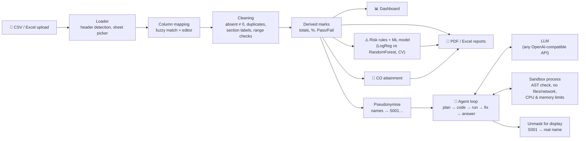

# 🎓 GradeLens — AI Student Performance Analyst

Upload a marks sheet (CSV or Excel) and get, in seconds:

- **An interactive dashboard** — fail rates by section and subject, a section × subject heatmap you can click to
  drill down, score and grade distributions, attendance impact, MST-1 → MST-2 trends, subject difficulty.
- **An AI analyst you can ask in plain English** — *"Which section has the highest fail rate in Python?"*,
  *"Which students passed MST-1 but failed MST-2?"*. It writes and runs pandas/SQL code on your data, fixes its own
  errors, and answers with tables and charts. You can see every line of code it ran.
- **An at-risk student list** — a risk score with readable reasons for every student, plus a machine-learning model
  (logistic regression vs random forest, chosen by cross-validation) that learns which early signs come before a fail.
- **CO attainment** (OBE / NBA style) from question-wise marks, with editable thresholds.
- **One-click PDF and Excel reports** for your HOD.
- **Student profiles** — radar chart vs class average, MST trend, attendance, risk reasons.

Messy sheets are fine: odd column names, title rows, `AB` / `Absent` markers, `Sec A` vs `a`, duplicates and typos
are detected, fixed where safe, and listed in the **Data Quality** tab.

Everything except the AI chat works **without an API key**.

---

## Quickstart (3 steps)

1. **Install Python 3.11+** from [python.org](https://www.python.org/downloads/) (on Windows tick *Add python.exe to PATH*).
2. **Download this folder** and open a terminal in it.
3. **Run it:**
   - macOS / Linux: `./run.sh`
   - Windows: double-click `run.bat`

The script creates a virtual environment, installs everything (a few minutes the first time), and opens
<http://localhost:8501>. Click **▶ Load sample data** to explore with 180 synthetic students.

> To use **Ask AI**, open **⚙️ AI settings** in the sidebar and paste a key (see [AI setup](#ai-setup)), or put it in a
> `.env` file (copy `.env.example`).

---

## AI setup

GradeLens talks to any **OpenAI-compatible** endpoint. Pick one:

| Provider | Cost | Get a key | Settings |
|---|---|---|---|
| **Google Gemini** | Free tier | [aistudio.google.com/apikey](https://aistudio.google.com/apikey) | `LLM_PROVIDER=gemini` |
| **Groq** | Free tier | [console.groq.com/keys](https://console.groq.com/keys) | `LLM_PROVIDER=groq` |
| **OpenAI** | Paid | [platform.openai.com/api-keys](https://platform.openai.com/api-keys) | `LLM_PROVIDER=openai` |
| **OpenRouter** | Paid / some free models | [openrouter.ai/keys](https://openrouter.ai/keys) | `LLM_PROVIDER=openrouter` |
| **Ollama** (offline, on your PC) | Free | none — install [Ollama](https://ollama.com), run `ollama pull qwen3:8b` | `LLM_PROVIDER=ollama` |
| **Anything else** | — | — | `LLM_PROVIDER=custom`, `LLM_BASE_URL=…`, `LLM_MODEL=…` |

Then either:

- **In the app:** sidebar → **⚙️ AI settings** → choose the provider → paste the key → **Test connection**
  (kept for that browser session only), or
- **In a `.env` file** (local / Docker): `cp .env.example .env` and fill in `LLM_PROVIDER` and `LLM_API_KEY`, or
- **In Streamlit secrets** (cloud): see [Streamlit Community Cloud](#streamlit-community-cloud).

| Variable | Meaning | Default |
|---|---|---|
| `LLM_PROVIDER` | `openai`, `gemini`, `groq`, `openrouter`, `ollama`, `custom` | `openai` (or inferred from the URL) |
| `LLM_API_KEY` | Provider API key | — (not needed for Ollama) |
| `LLM_MODEL` | Model name (must support tool calling) | `gpt-5.4-mini`, `gemini-3.8-flash`, `openai/gpt-oss-120b`, `qwen3:8b` |
| `LLM_BASE_URL` | API URL ending in `/v1` | the provider's URL |
| `GRADELENS_MODEL_DIR` | Where a saved at-risk model is kept | `./models` |

Default model names were checked against the providers' documentation in October 2026; providers rename models
often, so if you see *"model not found"*, set `LLM_MODEL` to a current one.

**Privacy:** student names and roll numbers are replaced with IDs (S001, S002, …) before anything is sent to the AI —
including names you type into a question. The AI only ever sees IDs; GradeLens swaps the real names back in when it
shows you the answer. "Write with AI" for reports sends only aggregate numbers.

---

## Your data

GradeLens reads `.csv`, `.xlsx` and `.xls`. If a workbook has several sheets you pick one. Column names are matched
automatically (`Roll No`, `Enrollment No`, `Mid Sem 1`, `MST 1`, `Att %` …) and you can correct the mapping in the
**Data Quality** tab.

**Long format** — one row per student per subject:

| Roll No | Student Name | Section | Semester | Subject | Attendance % | Assignment | MST 1 | MST 2 | End Term | Total | Result |
|---|---|---|---|---|---|---|---|---|---|---|---|
| 2023BCA001 | Aarav Sharma | A | 5 | Python | 82 | 8 | 12 | 13 | 44 | 77 | Pass |

**Wide format** — one row per student, columns per subject:

| Roll No | Name | Section | Python - MST1 | Python - MST2 | DBMS - MST1 | DBMS - MST2 | … |
|---|---|---|---|---|---|---|---|

You need at least a **roll number or name** and **some marks**. Everything else is optional; a sheet with only MSTs
works as a mid-semester sheet. Max marks (default assignment 10, MSTs 15, end term 60) are detected from headers such
as `MST-1 (24)` or from the data, and can be changed under **Marks scheme** in the sidebar. The pass mark (default 40%)
and attendance requirement (default 75%) are sliders.

**CO attainment** needs a separate question-wise sheet: one row per student, columns `Q1, Q2, …` (optionally
`Q1 (10)` to give max marks). Map each question to a CO in the **🎯 CO Attainment** tab.

---

## Deploy

### Docker

```bash
cp .env.example .env            # optional: add your AI key
docker compose up --build       # → http://localhost:8501
```

Or without Compose:

```bash
docker build -t gradelens .
docker run -p 8501:8501 -e LLM_PROVIDER=gemini -e LLM_API_KEY=your-key gradelens
```

The image is `python:3.11-slim`, runs as a non-root user, has a `HEALTHCHECK` on `/_stcore/health`, and Compose keeps a
saved at-risk model in a named volume. To use Ollama on the host from inside Docker, set
`LLM_PROVIDER=ollama` and `LLM_BASE_URL=http://host.docker.internal:11434/v1`.

### Streamlit Community Cloud

1. Push this folder to a GitHub repository.
2. At [share.streamlit.io](https://share.streamlit.io) → **Create app** → pick the repo, branch and `app.py`.
   Under **Advanced settings** choose Python **3.11**.
3. In **Secrets**, paste the contents of `.streamlit/secrets.toml.example` with your key filled in. Deploy.

Uploads are limited to 50 MB (`.streamlit/config.toml`). Files are processed in memory and never stored.

### Any Linux server

```bash
python3.11 -m venv .venv && .venv/bin/pip install -r requirements.txt
.venv/bin/streamlit run app.py --server.port 8501 --server.address 0.0.0.0
```

Put it behind a reverse proxy (nginx / Caddy) with HTTPS if it faces the internet.

---

## How it works



**The AI agent loop** (ReAct): the model gets the column dictionary, the marks scheme and 5 *masked* sample rows —
never the whole dataset. It calls tools (`run_python`, `run_sql`, `get_column_values`, `final_answer`); GradeLens runs
the code in a sandbox and sends back at most 30 rows of output. If the code fails, the error goes back to the model,
which rewrites it (up to 3 retries, 6 steps in total). All numbers come from executed code, not from the model's memory.

**The sandbox:** code is parsed with Python's `ast` and rejected if it imports anything, touches dunder attributes,
uses `eval`/`exec`/`open`/`getattr`, or calls file/network methods (`to_csv`, `read_csv`, …). It then runs in a separate
process with restricted built-ins, no environment variables (so it can't see API keys), CPU/memory/file-size limits and
a 10-second timeout. SQL runs in DuckDB with external access disabled; only `SELECT`/`WITH` is allowed.

**At-risk scoring:** transparent points for failed subjects, internals below pass, low attendance, sharp MST-2 drops,
narrow passes and absences (details in the app under *How the risk score works*). When the sheet has final results,
a model trained only on early indicators (attendance, assignment, MST-1, MST-2) adds a fail probability for subjects
not yet failed. **💾 Save for mid-semester use** keeps that model to score next semester's sheet early.
It is decision support, not a verdict.

### Project layout

```
app.py                 entry point: layout, tabs, wiring
core/                  loading, column mapping, cleaning, analytics, CO attainment, config, palette
agent/                 LLM client + MockLLM, agent loop, tools, prompts, masking, sandbox (+ worker process)
ml/risk_model.py       rule scores, model training/evaluation, save/load
reports/               report data + summary, PDF (ReportLab), Excel (openpyxl), matplotlib charts
ui/                    one module per tab, sidebar, charts (Plotly), theme, AI settings
scripts/               sample data generator
tests/                 pytest suite (+ a fake OpenAI-compatible server for integration tests)
```

---

## Development

```bash
python3.11 -m venv .venv && .venv/bin/pip install -r requirements-dev.txt
.venv/bin/python -m pytest                                    # full suite
.venv/bin/python -m pytest --cov --cov-report=term-missing    # with coverage (core, agent, ml)
.venv/bin/ruff check . && .venv/bin/ruff format --check .
.venv/bin/python scripts/generate_sample_data.py              # regenerate sample_data/
```

Try the AI tab without any API key by running the bundled fake model (it writes buggy code, fixes it, and answers):

```bash
.venv/bin/python tests/fake_openai_server.py 8765 &
LLM_PROVIDER=custom LLM_BASE_URL=http://127.0.0.1:8765/v1 LLM_MODEL=fake .venv/bin/streamlit run app.py
```

Design choices are recorded in [DECISIONS.md](DECISIONS.md) and notable bugs in [DEBUG_LOG.md](DEBUG_LOG.md).

---

## Troubleshooting

**"Python was not found" / `run.sh: python3: not found`** — install Python 3.11 or newer and reopen the terminal.
On Windows, re-run the installer and tick *Add python.exe to PATH*.

**The Ask AI box is greyed out.** No AI model is configured. Open **⚙️ AI settings** in the sidebar, or set
`LLM_API_KEY` (see [AI setup](#ai-setup)).

**"rejected the API key"** — the key is wrong, expired or for a different provider. Check the provider choice.

**"Model … was not found"** — the provider renamed or retired it. Set `LLM_MODEL` to a current model that supports
tool (function) calling.

**"rate-limiting requests"** — free tiers allow a few requests per minute. Wait a minute; GradeLens already retries
with exponential backoff.

**The AI gives up or runs out of steps.** Be specific: name the subject and exam exactly as in your sheet
(e.g. "MST-2 in DBMS"). Expand **Show code** to see what it tried.

**My columns were detected wrongly.** Open **🧹 Data Quality** → *Column mapping*, fix the dropdowns, press
**Apply mapping**.

**Marks look wrong (e.g. everyone failing).** Check **Marks scheme** in the sidebar: the max marks must match your
sheet. GradeLens detects them from headers like `MST-1 (24)` and from the data, but you can override them.

**"Absent" students show as blank, not 0.** That's deliberate: absence is reported separately, and averages skip it.
For pass/fail an absent component earns 0 marks, and absence in the end-term exam is a fail.

**The at-risk model isn't used.** It needs end-term results with at least 100 graded records and 10 fails. With less,
GradeLens uses the rule-based score and says why. For mid-semester sheets, first train and **💾 save** a model on a
past semester's final results.

**Port 8501 is busy.** `PORT=8600 ./run.sh` (macOS/Linux) or `set PORT=8600` then `run.bat` (Windows).

**Docker: `host.docker.internal` doesn't resolve (Linux).** Use `docker compose`, which adds it, or pass
`--add-host=host.docker.internal:host-gateway` to `docker run`.
